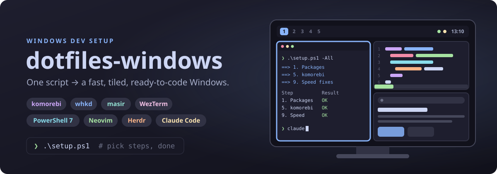
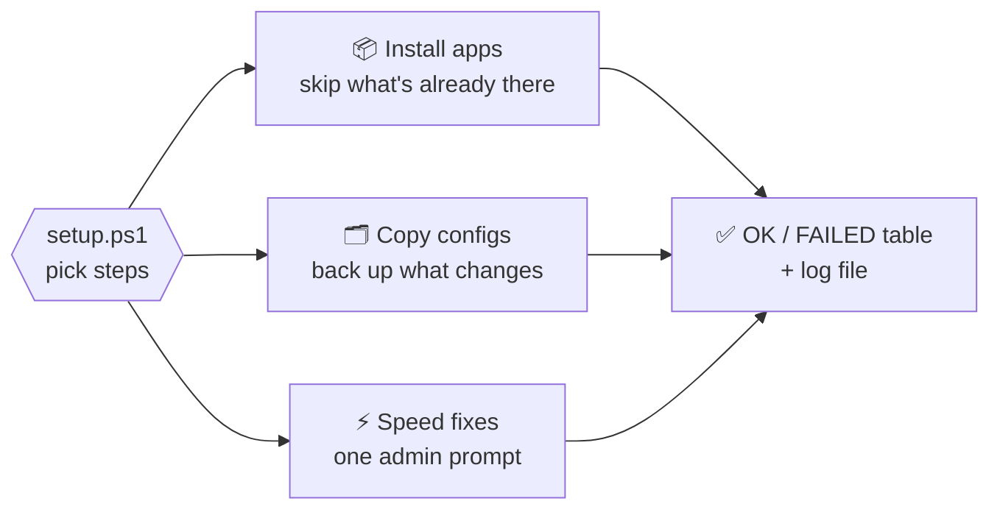
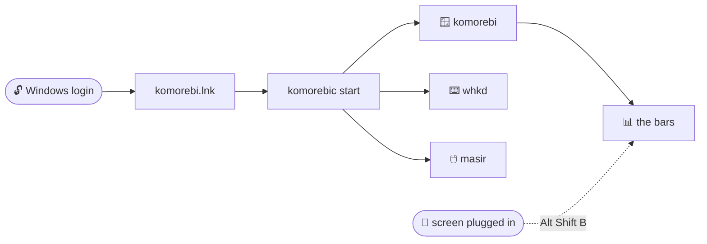
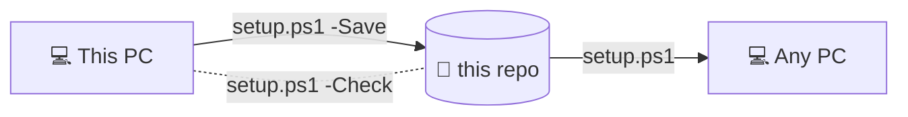

<p align="center">
  
</p>

<p align="center">
  
  
  
  
  
  
</p>

<p align="center">
  <a href="#quick-start">Quick start</a> ·
  <a href="#steps">Steps</a> ·
  <a href="#how-it-works">How it works</a> ·
  <a href="#hotkeys">Hotkeys</a> ·
  <a href="#sync">Keep it in sync</a> ·
  <a href="#troubleshooting">Troubleshooting</a>
</p>

---

## ✨ What you get

<table>
<tr>
<td width="50%">🪟 <b>Tiling desktop</b><br>one komorebi config that knows every screen (laptop, home, office) and tiles any new one too, a bar with workspaces, and rules that keep popups, picture-in-picture and call bars out of the tiles</td>
<td width="50%">⌨️ <b>Instant hotkeys</b><br>whkd runs every hotkey through <code>cmd</code>: ~0.05 s per keypress instead of ~0.5 s</td>
</tr>
<tr>
<td>🖱️ <b>Focus follows mouse</b><br>masir focuses the window under the cursor, but only windows komorebi manages</td>
<td>🚀 <b>Starts at login</b><br>komorebi's own autostart runs komorebi, whkd, masir and the bars, no scripts</td>
</tr>
<tr>
<td>🐚 <b>Shell</b><br>PowerShell 7 with starship, zoxide, fzf, eza, bat and git shortcuts</td>
<td>📝 <b>Editor</b><br>your Neovim config, cloned and ready</td>
</tr>
<tr>
<td>🤖 <b>Agents</b><br>Herdr and Claude Code with settings, status line and hooks</td>
<td>⚡ <b>Speed fixes</b><br>no startup-app delay, no power throttling of background tools</td>
</tr>
</table>

<a id="quick-start"></a>

## 🚀 Quick start

Open a **normal** (not admin) PowerShell window on the new PC:

```powershell
winget install --id Git.Git -e        # then open a new PowerShell window
git clone https://github.com/bewithsnehasish/dotfiles-windows "$HOME\Github\dotfiles-windows"
cd "$HOME\Github\dotfiles-windows"
powershell -ExecutionPolicy Bypass -File .\setup.ps1
```

You get a menu. Type the numbers you want (`1 3 5`), `a` for everything, or Enter to quit:

```text
Windows setup - pick what to set up:

   1) Packages     scoop apps, PowerShell 7, WezTerm, Node, masir, PowerShell modules
   2) Shell        PowerShell profile + starship prompt
   3) WezTerm      terminal config
   4) Neovim       clone nvim-config (windows branch)
   5) komorebi     tiling + whkd hotkeys + masir + bar, started at login
   6) Herdr        agent workspace config
   7) Claude Code  CLI, settings, status line, hooks
   8) Git + SSH    git config and SSH host aliases (keys are never in the repo)
   9) Speed fixes  no startup-app delay, no power throttling (one admin prompt)
  10) Cleanup      remove komorebi leftovers, tips for startup apps
```

> [!TIP]
> Skip the menu with `.\setup.ps1 -Steps 2,5` or `.\setup.ps1 -All`.
> When it finishes: **restart Windows**, open `nvim` once so it installs its plugins, and run `claude` once to sign in.

<a id="steps"></a>

## 🧩 Steps

| # | Step | What it does |
|:-:|------|--------------|
| 1 | 📦 **Packages** | Installs scoop and every app in [`packages/scoopfile.json`](packages/scoopfile.json), the winget apps in [`packages/winget.txt`](packages/winget.txt) (PowerShell 7, WezTerm, Node 22, masir), and the PowerShell modules posh-git, Terminal-Icons and PSFzf |
| 2 | 🐚 **Shell** | PowerShell 7 profile and the starship prompt |
| 3 | 🖥️ **WezTerm** | `~\.wezterm.lua` |
| 4 | 📝 **Neovim** | Clones [nvim-config](https://github.com/bewithsnehasish/nvim-config) (`windows` branch) into `%LOCALAPPDATA%\nvim` |
| 5 | 🪟 **komorebi** | Layouts, bar, window rules, whkd hotkeys, masir, and autostart at login |
| 6 | 🐑 **Herdr** | Herdr config |
| 7 | 🤖 **Claude Code** | Installs the CLI, then settings, status line and hooks |
| 8 | 🔑 **Git + SSH** | `.gitconfig` and SSH host aliases: `github.com` = work, `github-pr` = personal. Keys are never stored here |
| 9 | ⚡ **Speed fixes** | Login apps start with no delay; power throttling off (one admin prompt, then restart) |
| 10 | 🧹 **Cleanup** | Removes komorebi's empty leftover files and points you to the startup-apps list |

<a id="how-it-works"></a>

## 🔍 How it works

Every step is **safe to run again**. Finished work is skipped, any file that gets replaced is backed up first (`<file>.bak-<date>`), and one failing step never stops the rest.



**At login**, komorebi's own startup shortcut runs `komorebic start --whkd --bar --masir`. There are no scripts. If you dock after logging in, press <kbd>Alt</kbd> <kbd>Shift</kbd> <kbd>B</kbd> to give the new screen its bar:



**One config for every desk.** `komorebi.json` knows each screen by its serial number, so docking needs no switching:

| Screen | Workspaces |
|---|---|
| 💻 Laptop panel | 6 – 9 at home, 4 – 6 at the office, **all 1 – 9 on its own** |
| 🏠 Home Lenovo L24 | 1 – 5 |
| 🏢 Office Samsung left / right | 1 – 3 / 7 – 9 |
| 📽️ Any other screen (projector, hotel TV) | one plain tiled workspace, no setup |

The laptop is listed last, so when docked the bigger screen wins workspaces 1 – 5; undocked, the laptop's own 1 – 5 take over. Unplug a screen and komorebi keeps its layout; plug it back in and its windows return. Windows you opened on the laptop's 1 – 5 while undocked stay on the laptop after docking: click that workspace on the laptop's bar and send each window over with <kbd>Alt</kbd> <kbd>Shift</kbd> + its number.

<a id="hotkeys"></a>

## ⌨️ Hotkeys

#### 🪟 Windows

| Keys | Action |
|---|---|
| <kbd>Alt</kbd> <kbd>H</kbd> <kbd>J</kbd> <kbd>K</kbd> <kbd>L</kbd> | Focus left / down / up / right |
| <kbd>Alt</kbd> <kbd>Shift</kbd> <kbd>H</kbd> <kbd>J</kbd> <kbd>K</kbd> <kbd>L</kbd> | Move window |
| <kbd>Alt</kbd> <kbd>Shift</kbd> <kbd>Enter</kbd> | Promote to the main slot |
| <kbd>Alt</kbd> <kbd>T</kbd> | Float / tile |
| <kbd>Alt</kbd> <kbd>F</kbd> | Maximise |
| <kbd>Alt</kbd> <kbd>Shift</kbd> <kbd>F</kbd> | Monocle (one window fills the screen) |
| <kbd>Alt</kbd> <kbd>Q</kbd> / <kbd>Alt</kbd> <kbd>M</kbd> | Close / minimise |
| <kbd>Alt</kbd> <kbd>-</kbd> / <kbd>=</kbd> | Narrower / wider (<kbd>Shift</kbd> for height) |
| <kbd>Alt</kbd> <kbd>←</kbd> <kbd>↓</kbd> <kbd>↑</kbd> <kbd>→</kbd> | Stack with the neighbour |
| <kbd>Alt</kbd> <kbd>;</kbd> | Unstack |
| <kbd>Alt</kbd> <kbd>[</kbd> / <kbd>]</kbd> | Cycle through a stack |

#### 🗂️ Workspaces & monitors

| Keys | Action |
|---|---|
| <kbd>Alt</kbd> <kbd>1</kbd> … <kbd>9</kbd> | Go to workspace |
| <kbd>Alt</kbd> <kbd>Shift</kbd> <kbd>1</kbd> … <kbd>9</kbd> | Send window to workspace |
| <kbd>Alt</kbd> <kbd>,</kbd> / <kbd>.</kbd> | Previous / next monitor |
| <kbd>Alt</kbd> <kbd>Shift</kbd> <kbd>,</kbd> / <kbd>.</kbd> | Send window to monitor |
| <kbd>Alt</kbd> <kbd>X</kbd> / <kbd>Y</kbd> | Flip layout |
| <kbd>Alt</kbd> <kbd>Shift</kbd> <kbd>R</kbd> | Retile |
| <kbd>Alt</kbd> <kbd>P</kbd> | Pause komorebi |

#### 🚀 Apps

| Keys | Action |
|---|---|
| <kbd>Alt</kbd> <kbd>Enter</kbd> | WezTerm |
| <kbd>Alt</kbd> <kbd>B</kbd> | Helium (focus if open, else launch) |
| <kbd>Alt</kbd> <kbd>S</kbd> | Slack (focus if open, else launch) |
| <kbd>Alt</kbd> <kbd>E</kbd> | Explorer |
| <kbd>Alt</kbd> <kbd>Shift</kbd> <kbd>Esc</kbd> | Task Manager |

#### 🔁 Reload

| Keys | Action |
|---|---|
| <kbd>Alt</kbd> <kbd>Shift</kbd> <kbd>B</kbd> | Restart the bars (after docking) |
| <kbd>Alt</kbd> <kbd>O</kbd> | Reload whkd |
| <kbd>Alt</kbd> <kbd>Shift</kbd> <kbd>O</kbd> | Reload komorebi config |

<a id="sync"></a>

## 🔄 Keep it in sync



After changing a config on this PC:

```powershell
.\setup.ps1 -Check   # which configs differ from the repo
.\setup.ps1 -Save    # copy this PC's configs and scoop app list into the repo
git add -A; git commit -m "update configs"; git push
```

Paths under your user folder are stored as placeholders (`{{HOME}}`), so the configs work for any Windows username. `.gitattributes` keeps every file byte-for-byte.

<details>
<summary><b>📂 Where each config lives</b></summary>

| In this repo | On the PC |
|---|---|
| `powershell/Microsoft.PowerShell_profile.ps1` | `Documents\PowerShell\` |
| `starship/starship.toml` | `~\.config\` |
| `wezterm/.wezterm.lua` | `~\` |
| `komorebi/*` | `~\` |
| `whkd/whkdrc` | `~\.config\` |
| `herdr/config.toml` | `%APPDATA%\herdr\` |
| `claude/*` | `~\.claude\` |
| `git/.gitconfig`, `git/ssh-config` | `~\.gitconfig`, `~\.ssh\config` |

To add a new config, add one line to the `$Configs` list at the top of `setup.ps1`, then run `-Save`.

</details>

## 💡 Good to know

> [!NOTE]
> **Window rules** live in `komorebi/komorebi.my-rules.json`, loaded on top of the community `applications.json`. Add a rule by hand, then press <kbd>Alt</kbd> <kbd>Shift</kbd> <kbd>O</kbd>. If a window's title changes every time, use `"matching_strategy": "Contains"`.

> [!IMPORTANT]
> **Screen IDs** in `komorebi.json` (`display_index_preferences`) belong to this laptop's screens. To pin a new everyday screen (or on another laptop), run `komorebic monitor-information`, add its `serial_number_id` (the `device_id` for a built-in panel) with a `workspaces` block in the same position, and copy a `komorebi.bar.monitorN.json` with the next index. In Windows **Settings → System → Display → Multiple displays**, turn off *Remember window locations* and turn on *Minimize windows when a monitor is disconnected*.

> [!WARNING]
> In `whkdrc`, don't put `# comments` at the end of a command line: `cmd` would pass them on as arguments.

> [!CAUTION]
> Keep this repo **private**: the Claude settings describe work systems.

<a id="troubleshooting"></a>

## 🛠️ Troubleshooting

<details>
<summary><b>komorebi isn't running after login</b></summary>

Run `komorebic start --whkd --bar --masir`. If that works, check that `komorebi.lnk` exists in `shell:startup` (re-run step 5 to recreate it).
</details>

<details>
<summary><b>Hotkeys do nothing</b></summary>

Press <kbd>Alt</kbd> <kbd>O</kbd> or run `whkd`. After editing `whkdrc`, reload with <kbd>Alt</kbd> <kbd>O</kbd>.
</details>

<details>
<summary><b>Login apps are slow again after a Windows update</b></summary>

Updates can remove the startup-delay setting. Run step 9 again.
</details>

<details>
<summary><b>Undo the speed fixes</b></summary>

```powershell
Remove-Item HKCU:\Software\Microsoft\Windows\CurrentVersion\Explorer\Serialize -Recurse
# in an admin window:
reg delete HKLM\SYSTEM\CurrentControlSet\Control\Power\PowerThrottling /v PowerThrottlingOff /f
```
Then restart.
</details>

<details>
<summary><b>A step failed</b></summary>

The summary table shows the error, and the full output is in the log file whose path is printed at the end. Fix the cause and run that step again: everything else is skipped.
</details>
